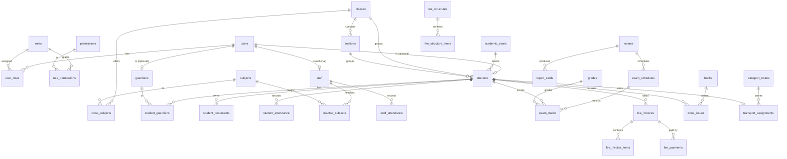

# Database Design

The schema targets **MySQL 8+** (InnoDB, `utf8mb4`). It is fully normalized with
foreign keys, indexes on all lookup/foreign-key columns, unique constraints on
natural keys, and soft-delete columns (`deleted_at`) on primary entities.

- Migrations: `database/migrations/*.sql` (run in filename order).
- Consolidated import: `database/schema.sql`.
- Seed data: `database/seeds/DatabaseSeeder.php`.
- Runner/CLI: `php bin/console migrate` / `seed` / `migrate:status`.

Total tables: **77** (InnoDB) plus the `migrations` tracking table. Applied via
**19 migration files** (`database/migrations/001…019_*.sql`).

### Portability & identity notes
- **Universal 12-digit `uid`**: `users, students, staff, classes, sections,
  subjects, academic_years, student_documents, exams` each carry a globally
  unique, immutable, never-reused 12-digit numeric ID (leading digit encodes the
  entity type). Generated by `IdSequenceService` (row-locked, concurrency-safe)
  and backed by a `UNIQUE` index. Used as a human-facing login identifier.
- **Section-optional schema**: `classes.uses_sections` toggles sections per class;
  `subject_attendance` uses a VIRTUAL `section_key = COALESCE(section_id,0)` so
  uniqueness works whether or not a class uses sections.
- **Duplicate-safe by DB constraint**: unique keys on attendance
  (`academic_year+class+section_key+subject+date+period+student`), exam marks,
  class-subject and teacher assignments, subject codes, and payment orders.

## Domain overview

| Domain          | Key tables |
|-----------------|-----------|
| Auth & RBAC     | `users`, `roles`, `permissions`, `role_permissions`, `user_roles`, `remember_tokens`, `password_resets`, `api_tokens`, `audit_logs` |
| Academic        | `academic_years`, `classes`, `sections`, `subjects`, `class_subjects`, `syllabi` |
| Staff           | `departments`, `staff`, `teacher_qualifications`, `teacher_subjects` |
| Students        | `students`, `guardians`, `student_guardians`, `student_documents`, `student_promotions` |
| Attendance/TT   | `student_attendance`, `staff_attendance`, `rooms`, `timetable_slots`, `timetables` |
| Examinations    | `exam_types`, `exams` (with `uid`), `exam_schedules`, `grades`, `exam_marks`, `report_cards` |
| Teaching        | `teacher_assignments`, `teacher_assignment_history`, `class_teachers` |
| Fees & Payments | `fee_categories`, `fee_structures`, `fee_structure_items`, `fee_discounts`, `fee_invoices`, `fee_invoice_items`, `fee_payments`, `payment_transactions` |
| Workflow        | `attendance_unlock_requests`, `subject_attendance`, `update_logs` |
| Auth extras     | `login_attempts` (brute-force / login history) |
| Library         | `book_categories`, `books`, `book_issues` |
| Transport       | `transport_routes`, `vehicles`, `transport_assignments` |
| Hostel          | `hostels`, `hostel_rooms`, `hostel_allocations` |
| Inventory       | `item_categories`, `vendors`, `inventory_items`, `purchases`, `purchase_items` |
| HR & Payroll    | `leave_types`, `leaves`, `holidays`, `payrolls` |
| Communication   | `notices`, `messages`, `message_recipients`, `notifications`, `communication_logs` |
| Settings        | `settings` |

## Core relationships (ER)

## Conventions

- Primary keys: `BIGINT UNSIGNED AUTO_INCREMENT` for high-volume tables, `INT UNSIGNED` for lookups.
- Timestamps: `created_at`, `updated_at` (nullable `DATETIME`, set by the ORM layer).
- Soft deletes: `deleted_at` on `users`, `staff`, `students`.
- Money: `DECIMAL(12,2)`. Percentages/GPA: `DECIMAL(5,2)`/`DECIMAL(4,2)`.
- Enumerations use MySQL `ENUM` for constrained status columns.
- Every foreign key has an explicit `ON DELETE` policy (`CASCADE` for owned rows,
  `SET NULL` for optional references).
